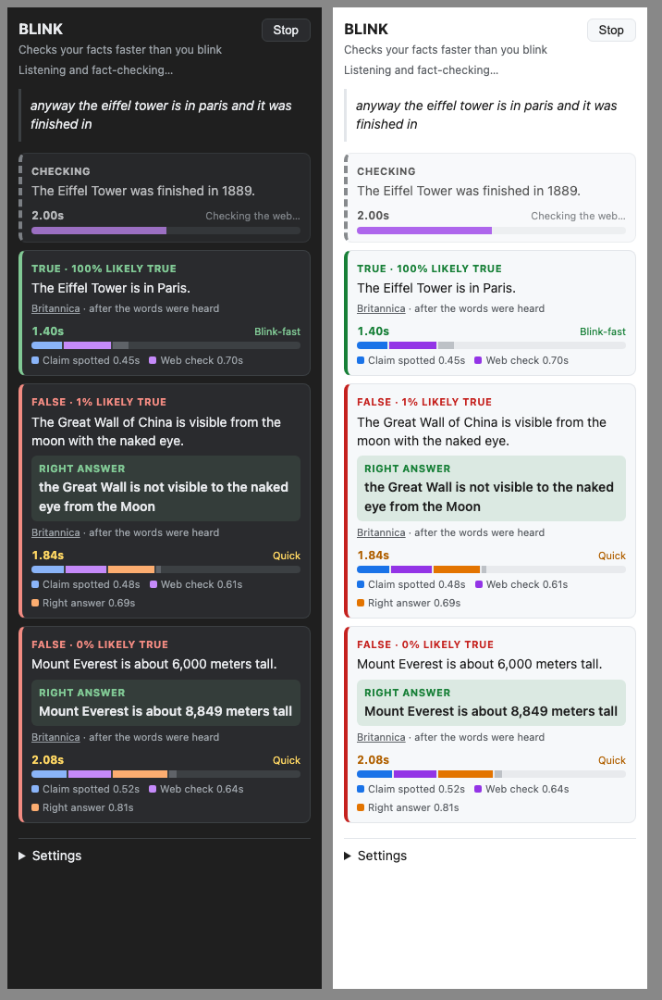

# BLINK

**Checks your facts faster than you blink.** BLINK listens to live audio, such as a YouTube video, a podcast or you talking, and checks every factual claim against the live web while the audio keeps playing. It reads each verdict out loud, with the right answer for anything false. It is built on AssemblyAI streaming speech-to-text and Parallel Decisions.

## Voice agent starter (original project)


Talk to a voice agent in your terminal. AssemblyAI handles speech and replies. Parallel’s hosted MCP server gives the agent three tools: Search finds evidence, Fetch reads a particular public page, and Decisions estimates a probability or chooses among supplied options. The first conversation only needs an AssemblyAI key. [Parallel MCP](https://docs.parallel.ai/integrations/mcp/quickstart)

## Run it

Install [uv](https://docs.astral.sh/uv/getting-started/installation/), then open a terminal:

```sh
git clone https://github.com/hsingh-aai/assemblyai-parallel-voice-agent.git
cd assemblyai-parallel-voice-agent
uv sync --frozen
```

Copy `.env.example` to `.env.local`. Set `ASSEMBLYAI_API_KEY` with your [AssemblyAI key](https://www.assemblyai.com/dashboard). Leave `PARALLEL_API_KEY` empty for free, rate-limited MCP access.

```sh
uv run python src/agent.py console --log-level info
```

Allow microphone access and wait for the greeting. To type instead, add `--text` to the command. Press Ctrl+C to quit.

### Hit the free-tier rate limit?

1. Press Ctrl+C to stop the agent. Get a key from the [Parallel dashboard](https://platform.parallel.ai).
2. Open the existing `.env.local` in the repo folder. Find `PARALLEL_API_KEY=`, paste your key after the equals sign, and save the file.
3. Run the same console command again and repeat your question. On startup, the agent picks up your key and uses your Parallel account for Search, Fetch, and Decisions. No code changes are needed.

## Try the three tools

1. **Search:** “What changed in the latest stable Python release?” The agent can answer directly from search excerpts.
2. **Fetch:** “Read the release notes you just cited. What do they say about upgrading?” The follow-up identifies a specific page. You can also paste a public URL in text mode.
3. **Decisions:** “How likely is it that Python 3.13 offers a free-threaded build? Give me a probability.” Decisions gathers its own evidence and estimates how likely the claim is to be true.

Watch the tool names in the terminal. The agent chooses when to call each one. Fetch is for a specific page or a missing detail, so a search that already answers the question needs only one call.

## Make it yours

Both Search and Decisions are already connected. Start with a pair of questions about the same subject. “Does Python 3.13 support free threading?” is a factual lookup. “Classify that support as stable, experimental, or explicitly unsupported” asks for a decision against supplied options. [See the prompt and tool input for this example](docs/decision-prompts.md).

Try a library compatibility assistant. Set `AGENT_GREETING="Which library are you working with?"` in `.env.local`. Add “Prefer official release notes and package metadata” to `INSTRUCTIONS` in [src/agent.py](src/agent.py). Restart and try similar questions about a library you use.

**Standalone API example.** To call Parallel directly from your own app, set `PARALLEL_API_KEY` with a [Parallel key](https://platform.parallel.ai). [parallel_api.py](src/parallel_api.py) has the two API calls and only needs `parallel-web`. [try_parallel.py](scripts/try_parallel.py) shows how to use them.

[Setup help](docs/advanced.md#troubleshooting) · [Browser and deployment options](docs/advanced.md#browser-or-room)

## Live fact checker

`src/fact_check_agent.py` listens to streaming audio and **tells you out loud** whether each claim it hears is true. When a claim is false, it says the right answer. It works on you talking, a meeting, or a podcast playing near the mic.

1. **AssemblyAI** streaming speech-to-text transcribes the audio and detects when each utterance ends.
2. One LLM call on the AssemblyAI gateway pulls out the checkable claims.
3. **One Parallel Decisions call** checks every claim in the utterance together. Decisions is Parallel's web-grounded System One model (`mode: "fast"`, usually under a second), and it returns the probability that each claim is true, with citations.
4. For a claim that is false or misleading, one quick LLM call writes **the right answer** from those citations.
5. The verdict is spoken by AssemblyAI text-to-speech, for example:
   - *"That's false. Actually, Mount Everest is about 8,849 metres tall. Source: Wikipedia."*
   - *"That checks out. Source: NASA."*

Listening never pauses during checks. True claims are announced as soon as Decisions answers, without waiting for any corrections. Every verdict is also printed with its probability and timings.

```sh
# Needs both ASSEMBLYAI_API_KEY and PARALLEL_API_KEY in .env.local
uv run python src/fact_check_agent.py console
```

Try saying: "The Great Wall of China is visible from the Moon, and Mount Everest is about six thousand metres tall."

| Setting | Default | Effect |
| --- | --- | --- |
| `FACTCHECK_SPEAK` | `all` | `all` speaks every verdict, `false` speaks only corrections, `off` only logs |
| `PARALLEL_DECISIONS_MODE` | `fast` | Parallel Decisions mode |
| `LLM_MODEL` | `gemma-4-31b` | AssemblyAI gateway model for claim extraction and corrections |

A probability of 0.75 or higher counts as true, 0.25 or lower as false, and anything between 0.25 and 0.45 as misleading. Everything else is reported as "couldn't verify". To change these cutoffs, edit `Thresholds` in `src/fact_check.py`.

## BLINK Chrome extension: fact-check YouTube and podcasts live

The `extension/` folder is a Chrome extension. It fact-checks whatever is playing in a tab, such as a YouTube video, a podcast or a live stream, and reads every verdict out loud while the video keeps playing.

```
Tab audio ──tabCapture──▶ offscreen doc ──16 kHz PCM / WebSocket──▶ stream_server.py (localhost)
                                                                     │  AssemblyAI streaming STT (word by word)
                                                                     │  live claim detection every 2 new words
                                                                     │  Parallel Decisions fires the moment a claim is complete
side panel + chrome.tts (spoken verdict) ◀────────── verdict JSON ──┘
```

**1. Start the backend.** It keeps your API keys on your machine, so the extension never sees them.

```sh
# .env.local needs ASSEMBLYAI_API_KEY and PARALLEL_API_KEY
uv run python src/stream_server.py      # listens on ws://127.0.0.1:8765/stream
```

**2. Load the extension.** Open `chrome://extensions`, turn on **Developer mode**, click **Load unpacked**, and choose the `extension/` folder.



**3. Use it.** Open a video and click the extension's toolbar icon. A side panel opens with live captions and a feed of verdict cards. Each card shows True, False, Misleading or Unverified, the probability, a highlighted **right answer** box for anything false, and the source. It also has a **latency meter**. While the check runs, the meter counts up live. When the verdict arrives, it shows the total time (green under 1.5 s, amber under 3 s, red above that), split into the time to spot the claim, the Parallel web check, and writing the right answer. Every verdict is also spoken, and the video's volume drops while the voice talks. Click the icon again, or **Stop**, to end.

### How it stays fast

- Audio streams continuously in 50 ms frames. Nothing waits for the video to end.
- AssemblyAI `universal-streaming-english` sends the transcript **word by word**.
- **No waiting for sentences.** Every 2 new words (`BLINK_STEP_WORDS`), the live transcript goes to claim detection. A Parallel Decisions web call fires the moment a claim is complete, often before the speaker reaches the end of the sentence. "The Eiffel Tower is in Paris, and it was finished in 1889" is checked twice: once right after "Paris", and again after "1889".
- Detection is careful with half-heard claims. "Everest is about six thousand…" isn't checked until it's clear the number has ended.
- Only one detection call runs at a time, always on the newest words, and web checks run in parallel. Claims that were already checked are skipped, even if they're reworded.
- True verdicts are sent the moment Decisions answers (about 0.6–0.8 s). Only false claims pay for the extra correction step.
- The spoken verdict uses Chrome's built-in text-to-speech, so there's no extra network hop.

Measured on a real podcast-style clip, verdicts arrive about 1.4–2.7 seconds after the claim's last word is spoken. The latency is shown on every card.

**Settings** (in the side panel): what to say out loud (every verdict, only false ones, or nothing), voice speed, and the server URL. Backend settings are `BLINK_STT_MODEL`, `BLINK_STEP_WORDS`, `BLINK_WINDOW_WORDS` (default 20, the minimum context; smaller is faster), `AAI_MIN_TURN_SILENCE`, `AAI_MAX_TURN_SILENCE` and `FACTCHECK_PORT`.

**Privacy:** tab audio is sent to AssemblyAI to be transcribed, and claims are sent to Parallel and the AssemblyAI LLM gateway. The backend binds to `127.0.0.1` and only accepts connections from Chrome extensions.

## Credits

This project is based on [hsingh-aai/assemblyai-parallel-voice-agent](https://github.com/hsingh-aai/assemblyai-parallel-voice-agent). The upstream code has no license file yet, and we have asked its author to add one. Until that happens, the upstream portions remain the original author's work.
